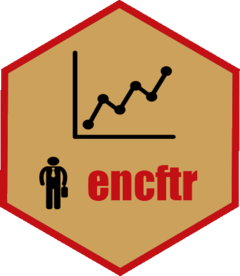

<!-- README.md is generated from README.Rmd. Please edit that file -->

# encftr 

<!-- badges: start -->

[](https://www.tidyverse.org/lifecycle/#experimental)
[](https://github.com/endomer-py/encftr/actions/workflows/R-CMD-check.yaml)
<!-- badges: end -->

`encftr` es un paquete para trabajar con la Encuesta Nacional Continua
de Fuerza de Trabajo (ENCFT) en R. Incluye utilidades para etiquetar
variables, construir indicadores derivados y calcular pobreza monetaria
con las metodologias 2012 y 2022.

## Instalacion

`encftr` no esta publicado en CRAN.

Puedes instalar la version de desarrollo desde GitHub con:

``` r
if (!requireNamespace("remotes", quietly = TRUE)) {
  install.packages("remotes")
}

remotes::install_github("endomer-py/encftr")
```

## Pobreza monetaria

El paquete expone tres entradas para pobreza monetaria:

- `ftc_pobreza_monetaria()` mantiene la ruta historica de 2012 y esta
  `deprecated`.
- `ftc_pobreza_monetaria_2012()` es la entrada explicita para la
  metodologia 2012.
- `ftc_pobreza_monetaria_2022()` es la entrada explicita para la
  metodologia 2022.

La recomendacion es llamar directamente a la funcion de la metodologia
que corresponda a tu flujo de trabajo.

``` r
encft_2012 <- ftc_pobreza_monetaria_2012(encft)
encft_2022 <- ftc_pobreza_monetaria_2022(encft)
```

Si tu tabla de entrada es amplia, `ftc_select_variables_pobreza()` ayuda
a quedarte solo con los insumos relevantes antes del calculo.

## Documentacion

La documentacion principal del paquete esta en el sitio pkgdown:

- Sitio del paquete: <https://endomer-py.github.io/encftr/>
- Introduccion:
  <https://endomer-py.github.io/encftr/articles/encftr.html>
- Pobreza monetaria:
  <https://endomer-py.github.io/encftr/articles/pobreza-monetaria.html>
- Diccionario de variables:
  <https://endomer-py.github.io/encftr/articles/diccionario.html>

## Cobertura actual

- Etiquetado y uso del diccionario de variables.
- Indicadores derivados y utilidades de procesamiento sobre la ENCFT.
- Calculo de pobreza monetaria con metodologias 2012 y 2022.
- Vinetas de introduccion, pobreza monetaria y diccionario.

## Contribuir

Si quieres reportar un problema o proponer cambios:

- Issues: <https://github.com/endomer-py/encftr/issues>
- Codigo de conducta:
  <https://github.com/endomer-py/encftr/blob/main/CODE_OF_CONDUCT.md>
